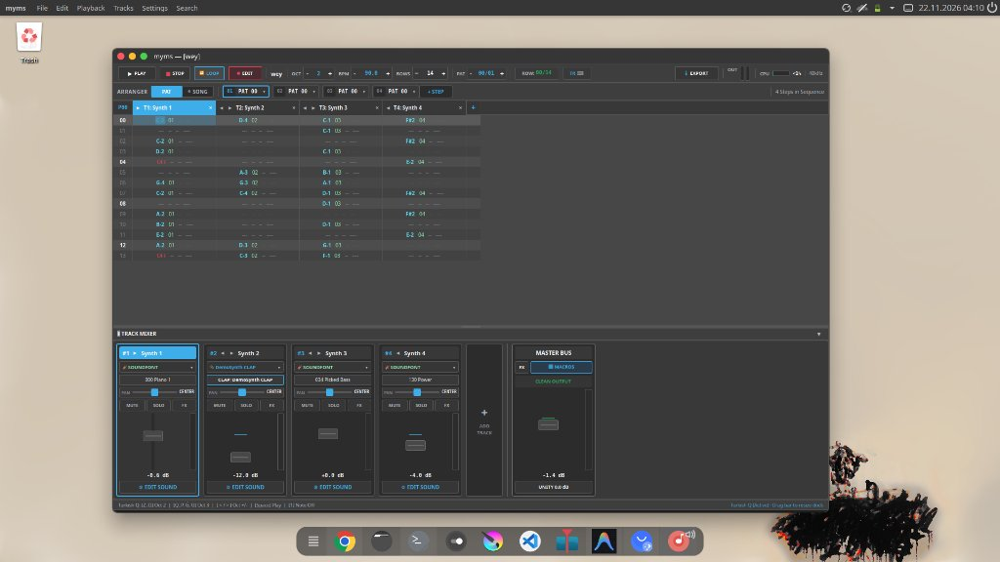

# myms

A lightweight tracker for Linux. 



## Features
- **Tracker Sequencer**: Keyboard-driven note, instrument, volume, and per-cell effect editing (`0x01`/`0x02` pitch slide, `0x0C` note cut/retrigger, `0x0E` delay send, `0x10` filter cutoff), rectangular chunk selection (`Ctrl+C`/`X`/`V`/`A`), and arbitrary per-pattern row counts.
- **Song Arranger**: Pattern/Song playback mode switch, drag-and-drop step reordering, step insertion/duplication, and auto-scrolling playhead tracking.
- **Built-in Instruments**:
  - **Synth**: Polyphonic subtractive synthesizer with dual oscillators, resonant filter, and ADSR envelopes.
  - **FontBox**: SoundFont2 (`.sf2`) GM player.
  - **BeatPad**: 8-slot drum sampler with per-pad pitch, decay, pan, volume, and reverse.
- **Plugin Hosting (VST3 & CLAP)**: Load 64-bit Linux VST3 (`.vst3`) and CLAP (`.clap`) instruments, Pre-FX, Post-FX, and Master Bus FX with native X11 editor window hosting.
- **Audio Export**: Offline rendering to **WAV** (built-in) and **FLAC / OGG / MP3** (via FFmpeg).

## Dependencies

### Required
- Python 3 + **PyQt6** (with Qt Quick / QML modules)
- `g++` (only needed on first run if `libmyms_audio.so` is not pre-built)

### Optional (Recommended)
- **FFmpeg** (`ffmpeg`) — required for FLAC, OGG, and MP3 audio export (WAV export works without FFmpeg).
- **General MIDI SoundFont** (`fluid-soundfont-gm` / `timgm6mb-soundfont`) — auto-detected from standard `/usr/share/sounds/sf2/` and `/usr/share/soundfonts/` locations.

### Installing Dependencies
- **Ubuntu / Debian**:
  ```bash
  sudo apt install python3-pyqt6 python3-pyqt6.qtquick g++ ffmpeg fluid-soundfont-gm
  ```
- **Arch Linux**:
  ```bash
  sudo pacman -S python-pyqt6 qt6-declarative gcc ffmpeg soundfont-fluid
  ```
- **Fedora**:
  ```bash
  sudo dnf install python3-qt6 qt6-qtdeclarative gcc-c++ ffmpeg fluid-soundfont-gm
  ```

## Running
```bash
./run.sh
```

## Desktop Entry
`myms.desktop` uses `Exec=myms`. If installing system-wide or to `~/.local/bin`, symlink or install `run.sh` (or a wrapper script) as `myms` in your `PATH`, and copy `myms.desktop` to `~/.local/share/applications/`.

## Credits & Third-Party Libraries
`myms` builds upon the work of the following open-source projects and authors:
- **[miniaudio](https://github.com/mackron/miniaudio)** by David Reid (`mackron`) — Public Domain / MIT-0
- **[TinySoundFont](https://github.com/schellingb/TinySoundFont)** by Bernhard Schelling (based on SFZero by Steve Folta) — MIT License
- **[CLAP (CLever Audio Plugin)](https://github.com/free-audio/clap)** by Alexandre Bique and the free-audio community — MIT License
- **[VST3 SDK C API](https://github.com/steinbergmedia/vst3sdk)** by Steinberg Media Technologies GmbH — MIT License (*VST is a trademark of Steinberg Media Technologies GmbH.*)
- **PyQt6 & Qt 6** by Riverbank Computing and The Qt Company — GPLv3 / LGPLv3
- **[FFmpeg](https://ffmpeg.org)** (optional runtime dependency for FLAC/OGG/MP3 export) — The FFmpeg developers

## License
`myms` is licensed under the **GNU General Public License v3.0 (GPL-3.0)**. See [LICENSE](LICENSE) for the full license text.

